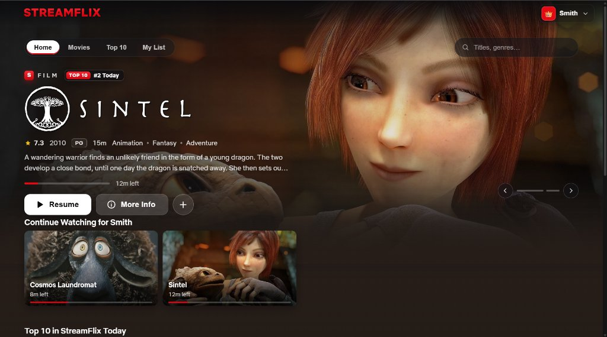
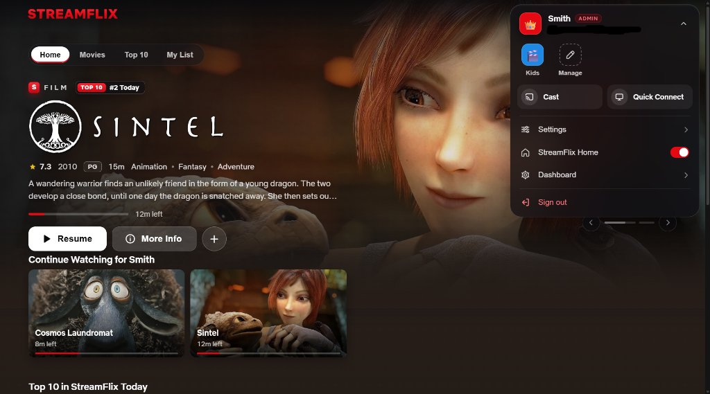
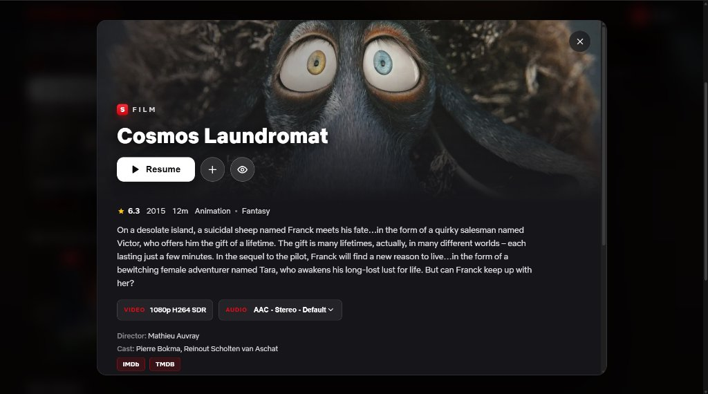
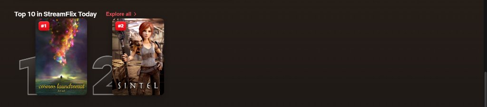
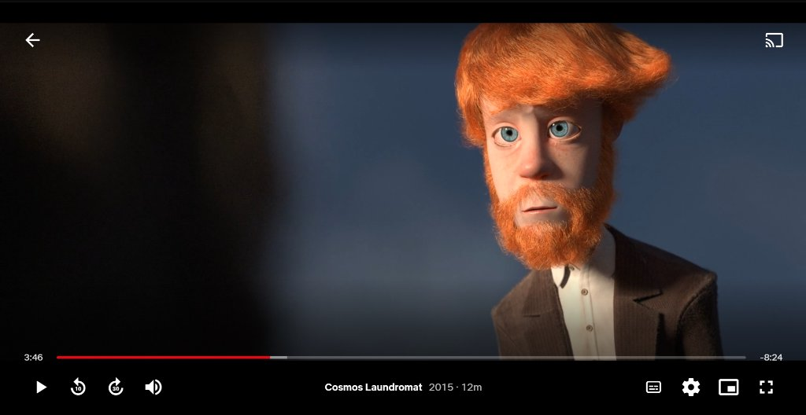
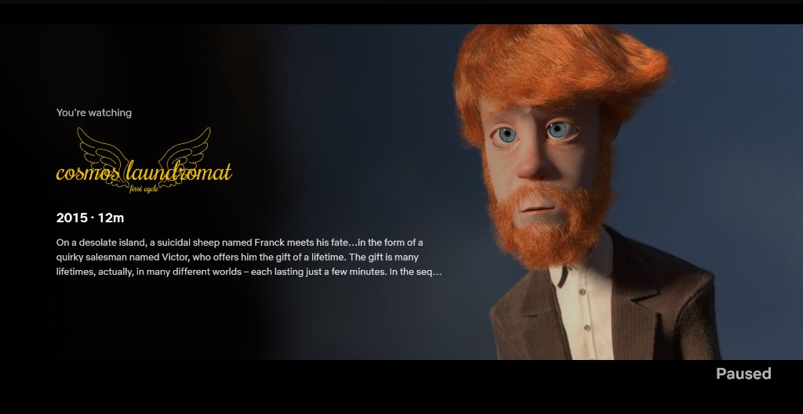
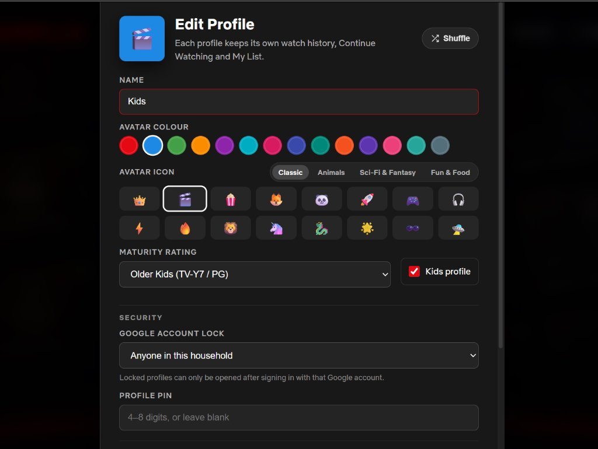
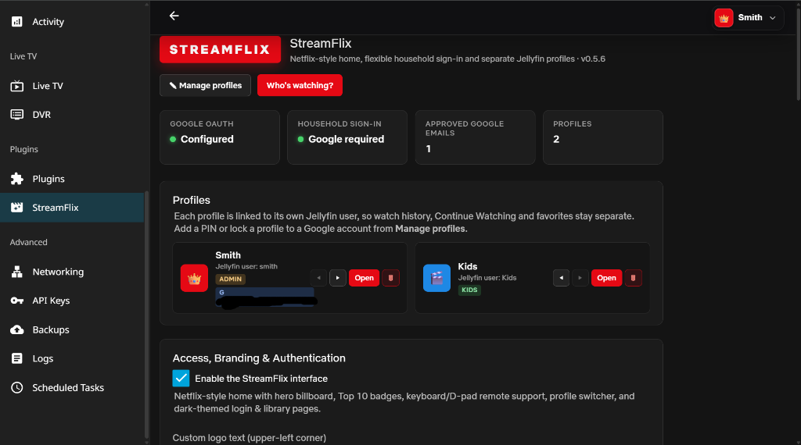

<div align="center">

# StreamFlix for Jellyfin

**A Netflix-style web UI, flexible household sign-in gate (Google OAuth, OIDC, Jellyfin & QR Guest Passes), native Seerr requests, and household profiles backed by real Jellyfin users.**

[](manifest.json)
[](manifest.json)
[](Jellyfin.Plugin.StreamFlix/Jellyfin.Plugin.StreamFlix.csproj)
[](LICENSE)

Runs entirely inside your existing Jellyfin server — no reverse-proxy sidecar, external database, or manual HTML edits required.

</div>

---

## Preview

<table>
  <tr>
    <td colspan="2" align="center">
      
      <br />
      <sub><b>1. StreamFlix Home &amp; Hero Billboard</b> — Full-bleed featured billboard, frosted category bar, instant search &amp; Continue Watching</sub>
    </td>
  </tr>
  <tr>
    <td width="50%" align="center" valign="top">
      
      <br />
      <sub><b>2. Household Sign-In Gate</b> — Clean pre-login gate (Google, OIDC &amp; Jellyfin login) with zero library exposure</sub>
    </td>
    <td width="50%" align="center" valign="top">
      
      <br />
      <sub><b>3. Who's Watching?</b> — Animated library mosaic with per-member profiles, Kids badges &amp; account/PIN locks</sub>
    </td>
  </tr>
  <tr>
    <td width="50%" align="center" valign="top">
      
      <br />
      <sub><b>4. Account Menu &amp; Profile Switcher</b> — One-click profile switching, Cast, Quick Connect &amp; StreamFlix Home toggle</sub>
    </td>
    <td width="50%" align="center" valign="top">
      
      <br />
      <sub><b>5. Title Details (&ldquo;More Info&rdquo;)</b> — Synopsis, video/audio stream picker, cast/director &amp; external links</sub>
    </td>
  </tr>
  <tr>
    <td colspan="2" align="center">
      
      <br />
      <sub><b>6. Top 10 in StreamFlix Today</b> — Configurable server rankings with bold <code>#1</code>&ndash;<code>#10</code> badges &amp; rank numerals</sub>
    </td>
  </tr>
  <tr>
    <td width="50%" align="center" valign="top">
      
      <br />
      <sub><b>7. Netflix-Style Video Player</b> — Slim red scrubber, 10s/30s skip, audio/subtitles, quality &amp; Picture-in-Picture</sub>
    </td>
    <td width="50%" align="center" valign="top">
      
      <br />
      <sub><b>8. &ldquo;You're Watching&rdquo; Pause Screen</b> — ClearLogo artwork, runtime &amp; synopsis overlay while paused</sub>
    </td>
  </tr>
  <tr>
    <td width="50%" align="center" valign="top">
      
      <br />
      <sub><b>9. Profile Customization &amp; Security</b> — 64 avatars, 14 accent colors, maturity ratings, Kids mode, multi-auth account lock &amp; PIN</sub>
    </td>
    <td width="50%" align="center" valign="top">
      
      <br />
      <sub><b>10. Plugin Administration</b> — Progressive sign-in methods, Guest Passes, Seerr integration, user mapping &amp; custom branding</sub>
    </td>
  </tr>
</table>

<p align="center">
  <sub>Demo library media courtesy of <a href="https://studio.blender.org/films/">Blender Studio Open Movies</a> (<a href="https://creativecommons.org/licenses/by/4.0/">CC BY</a>) — featuring <i>Sintel</i> and <i>Cosmos Laundromat</i> (&copy; Blender Foundation).</sub>
</p>

---

## Highlights

### Flexible Household Sign-In, Guest Passes & Security
- **Google OAuth, Custom OIDC (Beta), Jellyfin Login, or Hybrid Mode.** Household sign-in is always enforced before *"Who's watching?"*. Enable one or more progressive-disclosure **Sign-In Methods** — server-verified **Google Sign-In** (with one-click **Test OAuth Config**), self-hosted or cloud **Custom OpenID Connect (OIDC)** (`Authentik`, `Authelia`, `Pocket ID`, `Keycloak`, `Kanidm`, `Zitadel`, `Okta`, etc. via Authorization Code + PKCE `S256`, RSA/ECDSA JWKS verification, and one-click **Test OIDC Discovery**), **Jellyfin Username & Password Login**, or **Bypass Sign-In Gate on Home Network (LAN)**.
- **Temporary Guest Passes with local SVG QR codes.** Generate expiring invite links and zero-dependency, server-rendered QR codes locked to a single non-administrator profile with configurable duration (`4h`–`30d`) and device limits. Link-preview bots cannot burn redemptions, guests cannot switch into other profiles, and revoking or expiring a pass automatically deletes it and terminates active Jellyfin sessions immediately.
- **Opt-in Admin-Only Password Fallback (off by default).** Optionally add a subtle **Admin Sign-In** link on SSO screens that strictly enforces `IsAdministrator` on the backend (rejecting non-admin and disabled Jellyfin accounts with HTTP `403`), with an optional **LAN-only** IP restriction.
- **Multi-auth profile locks & randomized plugin passwords.** Protect any profile with a **4–8 digit PIN** (with target-scoped brute-force lockout) and/or lock it to a **Google email, OIDC email/username, or Jellyfin username** — displaying a matching provider badge on the profile tile. Dedicated Jellyfin users created by StreamFlix receive a cryptographically randomized 256-bit password automatically (while manually created Jellyfin accounts are never modified), secrets stay strictly server-side, and plugin configuration is mirrored atomically to persistent Jellyfin storage.
- **Admin-only user management & global device sign-out.** Only Jellyfin administrators can view server accounts, edit admin-linked profiles, manage Guest Passes, change which Jellyfin user backs a profile, or trigger **Sign out all devices** (revoking both StreamFlix household sessions and every Jellyfin device `AccessToken` across browsers, mobile apps, and Smart TVs).

### Real Multi-User Profiles
- **Separate history for everyone.** Every *"Who's watching?"* tile maps to its own Jellyfin Server User, keeping **Continue Watching, Next Up, My List, played state, and parental controls** completely independent.
- **Customizable branding, avatars & accents.** Customize the upper-left corner brand wordmark, choose from 64 categorized icons and 14 accent colors (with one-click Shuffle), and reorder profiles freely.
- **Quick Connect & Cast built in.** Pair Smart TVs and other Jellyfin apps straight from the profile menu via **Quick Connect** — signing that device in as the active profile's Jellyfin user — or launch **Cast** in one click.

### Cinematic Home, Seerr Requests & Discovery
- **Native Seerr / Jellyseerr / Overseerr integration.** Connect your Seerr instance in plugin settings (with one-click **Test Seerr Connection** and SSRF protection) to surface *Available to Request* Movie & TV Season cards directly inside Live Search — keeping your API key strictly on the server with optional Kids/Guest profile gates and zero navbar clutter.
- **Configurable Hero Billboard & Surprise Me.** Edge-to-edge hero with configurable slide count, auto-rotation interval (`0` to pause), content type, and library source filtering — paired with a frosted category bar (`Home`, `Shows`, `Movies`, `Top 10`, `My List`, `/` quick search, and a **Surprise Me** random unwatched title picker with **Shuffle Again**).
- **Dynamic Top 10 with `#1`–`#10` badges.** Choose server-wide most played, highest community rating, recently added, daily spotlight, or per-session randomized picks — complete with bold Netflix-style `#1`–`#10` rank badges.
- **Rich More Info & hover previews.** Detailed modals showcase ClearLogo title artwork, movie/series taglines, resume progress, audio/subtitle stream pickers, and **clickable Genre, Director & Cast chips** to browse matching titles in one click — alongside rich hover cards with one-click **Remove from Continue Watching (`×`)** + Undo.

### Netflix-Style Video Player
- **Streamlined controls.** Slim red scrubber, centered title, 10s/30s skip buttons, play/pause pulse feedback, and a *"You're watching"* pause screen.
- **In-player drawers & popovers.** Switch episodes instantly from the slide-in **Episodes & Seasons** drawer and change tracks live in the unified two-column **Audio & Subtitles** popover.
- **Seamless binge watching.** End-of-episode **Next Episode** countdown card (*Play Next* / *Watch Credits*) so multi-episode sessions keep flowing automatically.

### Desktop, Phone & Smart TV Ready
- **Mobile-tuned.** Single-row category bar with tap-to-expand search, touch-swipe hero billboard, 3-up snap-scrolling poster rows, bottom-sheet modals, and a collision-free landscape player.
- **10-foot Smart TV mode.** Automatically activates on `.layout-tv`, TV browsers, or `?tv=1` with overscan-safe margins, oversized poster/profile tiles, crisp focus halos, and full 2D spatial D-pad / remote navigation.

---

## Compatibility

The plugin repository manifest includes builds for all supported Jellyfin releases — Jellyfin automatically selects the package matching your server:

| Jellyfin Server | Target ABI | Runtime | Package |
| :--- | :--- | :--- | :--- |
| **12.x** (e.g. 12.4) | `12.0.0.0` | .NET 10.0 | `Jellyfin.Plugin.StreamFlix_12.0.0.zip` |
| **10.11.x** | `10.11.0.0` | .NET 9.0 | `Jellyfin.Plugin.StreamFlix_10.11.0.zip` |
| **10.9.x – 10.10.x** | `10.9.0.0` / `10.10.0.0` | .NET 8.0 | `Jellyfin.Plugin.StreamFlix_10.9.0.zip` |

---

## Installation

1. In Jellyfin, open **Dashboard → Plugins → Repositories** and add:
   ```text
   https://raw.githubusercontent.com/streamflix-dev/jellyfin-streamflix/main/manifest.json
   ```
2. Go to **Catalog**, locate **StreamFlix** (under *General*), and click **Install**.
3. **Restart Jellyfin** to load the plugin.

---

## Setup

1. Sign in to Jellyfin as an administrator and open **Dashboard → Plugins → StreamFlix**.
2. Under **Sign-In Methods**, toggle on one or more ways for your household to unlock *"Who's watching?"* (configuration fields expand automatically when enabled):
   - **Google Sign-In:** Create a *Web application* **OAuth 2.0 Client ID** in [Google Cloud Console → Credentials](https://console.cloud.google.com/apis/credentials) with the **Authorized JavaScript origins** and **Authorized redirect URIs** shown on the settings page, paste your **Client ID**, enter **Approved Google accounts** *(on a fresh install with an empty allowlist, the first Google account to sign in is approved automatically)*, and click **Test OAuth Config**.
   - **Custom OpenID Connect (OIDC):** Register the displayed **OIDC Redirect / Callback URI** in your identity provider (`Authentik`, `Authelia`, `Pocket ID`, `Keycloak`, `Kanidm`, `Zitadel`, `Okta`, etc.), enter your **Issuer / Discovery URL** and **Client ID** (plus optional Client Secret or allowlist), and click **Test OIDC Discovery**.
   - **Jellyfin Username & Password Login:** Allow any active Jellyfin server user to unlock the profile picker with their normal Jellyfin credentials — standalone or alongside Google/OIDC.
   - **Bypass Sign-In Gate on Home Network (LAN):** Let devices on private LAN subnets jump straight to *"Who's watching?"* while still enforcing authentication on remote WAN connections.
3. *(Optional)* Connect **Seerr / Jellyseerr / Overseerr** for live-search media requests, or generate **Temporary Guest Passes** (QR code / invite link) locked to a specific non-admin profile.
4. Click **Save**, then open **Manage Profiles** from the profile picker (or plugin settings) to create household profiles, link them to Jellyfin users, and configure **4–8 digit PINs** or **Google / OIDC / Jellyfin account locks**.

> [!TIP]
> Always protect any profile linked to your Jellyfin administrator account with a **PIN** or an **account lock** (Google email, OIDC identity, or Jellyfin username) so other household members cannot switch into it.

> [!NOTE]
> For security, household sign-in before *"Who's watching?"* cannot be disabled globally for remote connections. If you run SSO-only (`Google` or `OIDC`), you can optionally enable the **Admin-Only Password Fallback Link** (and restrict it to LAN IPs) as an emergency administrator login path.

---

## Building from Source

```bash
cd Jellyfin.Plugin.StreamFlix

dotnet build -c Release -p:JellyfinTarget=jf12     # Jellyfin 12.x        (.NET 10.0)
dotnet build -c Release -p:JellyfinTarget=jf1011   # Jellyfin 10.11       (.NET 9.0)
dotnet build -c Release -p:JellyfinTarget=jf109    # Jellyfin 10.9/10.10  (.NET 8.0)
```

Pushing code changes to `main` triggers [`.github/workflows/build-plugin.yml`](.github/workflows/build-plugin.yml), which compiles all three targets, packages `dist/*.zip`, and updates [`manifest.json`](manifest.json).

## Project Structure

```text
├── .github/workflows/build-plugin.yml   # Multi-target CI build & manifest generator
├── build.yaml                           # Jellyfin plugin build metadata
├── manifest.json                        # Jellyfin plugin repository manifest
├── docs/screenshots/                    # UI screenshots
└── Jellyfin.Plugin.StreamFlix/
    ├── Plugin.cs                        # Plugin entry point & throttled index.html injection
    ├── PluginServiceRegistrator.cs      # DI registration for services & startup filter
    ├── Configuration/
    │   ├── PluginConfiguration.cs       # Profiles, multi-auth, Guest Pass & Seerr config
    │   └── configPage.html              # Admin UI (Dashboard → Plugins → StreamFlix)
    ├── Controllers/
    │   └── StreamFlixController.cs      # Auth, OIDC, Guest Pass, Seerr & profile endpoints
    ├── Services/
    │   ├── StreamFlixOidcService.cs     # OIDC Relying Party (PKCE S256, discovery & JWKS verification)
    │   ├── StreamFlixQrCode.cs          # Zero-dependency ISO/IEC 18004 SVG QR code encoder
    │   ├── StreamFlixSeerrService.cs    # SSRF-hardened Seerr / Jellyseerr / Overseerr API client
    │   ├── StreamFlixSessionService.cs  # HMAC household/guest sessions & rate-limit tracking
    │   ├── StreamFlixStartupFilter.cs   # Request-time index.html script/style injection
    │   └── StreamFlixStartupTask.cs     # Jellyfin user provisioning, password hardening & linking
    └── Web/
        ├── streamflix.css               # Cinema theme, responsive/TV layouts & animations
        └── streamflix.js                # Sign-in gate, profile picker, home hub & player UI
```

## Credits

Demo library media courtesy of [Blender Studio Open Movies](https://studio.blender.org/films/) ([CC BY](https://creativecommons.org/licenses/by/4.0/)) — *Sintel* (© Blender Foundation | `durian.blender.org`, CC BY 3.0) and *Cosmos Laundromat* (© Blender Foundation | `gooseberry.blender.org`, CC BY 4.0).

## License

Licensed under the [GNU General Public License v3.0](LICENSE).

## Disclosure

AI tools assisted in the creation of this plugin, alongside a very long time spent designing, testing, and iterating to get everything working smoothly.
