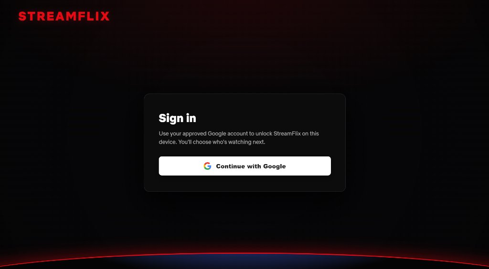
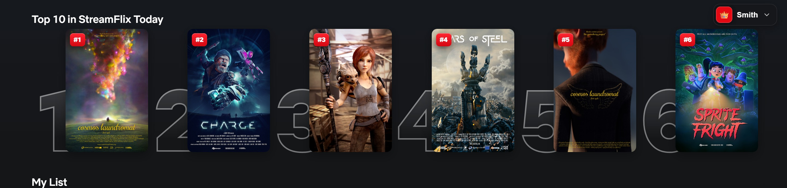
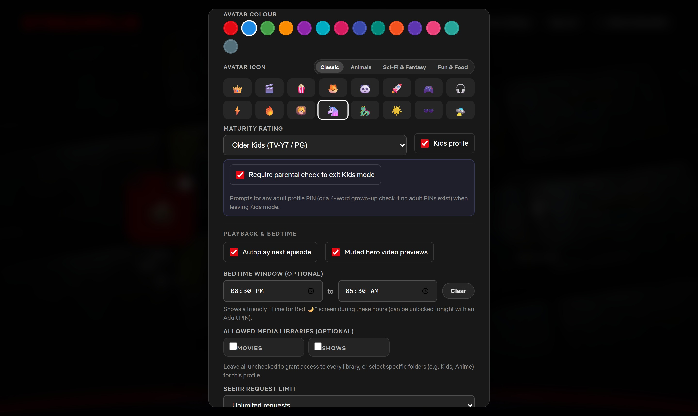

<div align="center">

# StreamFlix for Jellyfin

**A Netflix-style web UI, multi-auth household sign-in gate (Google OAuth, Custom OIDC, Jellyfin & QR Guest Passes), Dedicated Kids Mode, real-time synced Watch Together, liquid-glass mobile dock, native Seerr requests, and household profiles backed by real Jellyfin users.**

[](https://github.com/streamflix-dev/jellyfin-streamflix/releases)
[](https://github.com/streamflix-dev/jellyfin-streamflix/releases)
[](manifest.json)
[](Jellyfin.Plugin.StreamFlix/Jellyfin.Plugin.StreamFlix.csproj)
[](LICENSE)

Runs entirely inside your existing Jellyfin server — no reverse-proxy sidecar, external database, or manual HTML edits required.

</div>

---

## Preview

<table>
  <tr>
    <td colspan="2" align="center">
      
      <br />
      <sub><b>1. StreamFlix Home &amp; Hero Billboard</b> — Full-bleed featured billboard, frosted category bar, instant search, Surprise Me &amp; Continue Watching</sub>
    </td>
  </tr>
  <tr>
    <td colspan="2" align="center">
      
      <br />
      <sub><b>2. End-to-End OIDC Sign-In Flow</b> — Household Sign-In Gate &rarr; OpenID Connect provider &rarr; &ldquo;Who's watching?&rdquo; picker &rarr; StreamFlix Home</sub>
    </td>
  </tr>
  <tr>
    <td width="50%" align="center" valign="top">
      
      <br />
      <sub><b>3. Household Sign-In Gate</b> — Pre-login multi-auth gate (Google, Custom OIDC, Jellyfin &amp; Guest Passes) with zero library exposure</sub>
    </td>
    <td width="50%" align="center" valign="top">
      
      <br />
      <sub><b>4. Who's Watching?</b> — Animated library mosaic with real Jellyfin user profiles, Kids badges &amp; SSO/PIN locks</sub>
    </td>
  </tr>
  <tr>
    <td width="50%" align="center" valign="top">
      
      <br />
      <sub><b>5. Watch Together Live Room</b> — Server-synced play, pause, seek &amp; episode transitions plus 1-click 6-hour Guest Party links</sub>
    </td>
    <td width="50%" align="center" valign="top">
      
      <br />
      <sub><b>6. Temporary QR Guest Passes</b> — Expiring SVG QR invite links locked to a single non-admin profile with instant revocation</sub>
    </td>
  </tr>
  <tr>
    <td width="50%" align="center" valign="top">
      
      <br />
      <sub><b>7. Dedicated Kids Profile Mode</b> — Child-safe theme, Kids World filter bubbles, strict maturity enforcement &amp; Exit Kids lock</sub>
    </td>
    <td width="50%" align="center" valign="top">
      
      <br />
      <sub><b>8. Mobile Dock &amp; Phone Account Sheet</b> — Liquid-glass bottom navigation, clean category pills, Quick Connect &amp; phone Client Settings</sub>
    </td>
  </tr>
  <tr>
    <td width="50%" align="center" valign="top">
      
      <br />
      <sub><b>9. Account Pill Menu</b> — Instant profile switching, Cast, 6-digit Quick Connect modal, live Watch Together status, Media Requests &amp; Settings</sub>
    </td>
    <td width="50%" align="center" valign="top">
      
      <br />
      <sub><b>10. Title Details (&ldquo;More Info&rdquo;)</b> — Synopsis, video/audio stream picker, clickable cast/director/genre chips &amp; Watch Together launch</sub>
    </td>
  </tr>
  <tr>
    <td colspan="2" align="center">
      
      <br />
      <sub><b>11. Top 10 in StreamFlix Today</b> — Configurable server rankings with bold <code>#1</code>&ndash;<code>#10</code> badges &amp; rank numerals</sub>
    </td>
  </tr>
  <tr>
    <td width="50%" align="center" valign="top">
      
      <br />
      <sub><b>12. Netflix-Style Video Player</b> — Slim red scrubber, 10s/30s skip, Episodes &amp; Seasons drawer, Audio &amp; Subtitles popover &amp; Picture-in-Picture</sub>
    </td>
    <td width="50%" align="center" valign="top">
      
      <br />
      <sub><b>13. &ldquo;You're Watching&rdquo; Pause Screen</b> — ClearLogo artwork, runtime &amp; synopsis overlay while paused</sub>
    </td>
  </tr>
  <tr>
    <td width="50%" align="center" valign="top">
      
      <br />
      <sub><b>14. Profile Customization &amp; Security</b> — 64 avatars, 14 accent colors, maturity ratings, Kids mode, multi-auth account lock &amp; PIN</sub>
    </td>
    <td width="50%" align="center" valign="top">
      
      <br />
      <sub><b>15. 7-Tab Plugin Administration</b> — Streamlined console for Profiles, Sign-In &amp; SSO, Active Devices, Guest Passes, Home &amp; Hero, and Seerr</sub>
    </td>
  </tr>
</table>

<p align="center">
  <sub>Demo library media courtesy of <a href="https://studio.blender.org/films/">Blender Studio Open Movies</a> (<a href="https://creativecommons.org/licenses/by/4.0/">CC BY</a>) — featuring <i>Sintel</i> and <i>Cosmos Laundromat</i> (&copy; Blender Foundation).</sub>
</p>

---

## Highlights

### Flexible Multi-Auth Sign-In, Custom OIDC, Guest Passes & Security
- **Google OAuth, Custom OpenID Connect, Jellyfin Login, Household Password, or Hybrid Mode.** Household sign-in is enforced before *"Who's watching?"* so zero library artwork or metadata is exposed pre-login. Enable any combination of progressive-disclosure **Sign-In Methods**: server-verified **Google Sign-In** (with one-click **Test OAuth Config**), self-hosted or cloud **Custom OpenID Connect (OIDC)** (`Authentik`, `Authelia`, `Pocket ID`, `Keycloak`, `Kanidm`, `Zitadel`, `Okta`, etc. via Authorization Code + PKCE `S256`, RSA/ECDSA JWKS verification, RFC 6749 `client_secret_basic` / `client_secret_post` fallback, and one-click **Test OIDC Discovery**), **Jellyfin Username & Password Login**, **Household Password**, or **Bypass Sign-In Gate on Home Network (LAN)**.
- **Temporary SVG QR Guest Passes & native phone Share sheet.** Generate expiring invite links, pass codes, and zero-dependency server-rendered SVG QR codes locked to a single non-administrator profile with configurable duration (`1h`–`30d`) and device limits — plus a one-tap **Share** button (`navigator.share`) on mobile phones. Link-preview bots cannot burn redemptions, guests cannot switch into other profiles or view admin routes, and revoking or expiring a pass deletes it and terminates active Jellyfin sessions immediately.
- **Opt-in Admin-Only Password Fallback (off by default).** Optionally add a subtle **Admin Sign-In** link on SSO screens that strictly enforces `IsAdministrator` on the backend (rejecting non-admin and disabled Jellyfin accounts with HTTP `403`), with an optional **LAN-only** IP restriction.
- **Multi-auth profile locks & randomized plugin passwords.** Protect any profile with a **4–8 digit PIN** (with target-scoped brute-force lockout) and/or lock it to a **Google email, OIDC email/username/`sub`, or Jellyfin username** — displaying a matching provider badge on the profile tile. Dedicated Jellyfin users created by StreamFlix receive a cryptographically randomized 256-bit password automatically (while manually created Jellyfin accounts are never modified), secrets stay masked and strictly server-side, and plugin configuration is mirrored atomically to persistent Jellyfin storage.
- **Tabbed Admin Console, Active Devices manager & global sign-out.** Manage everything from the 7-tab **Dashboard → Plugins → StreamFlix** console (`All Settings`, `Profiles`, `Sign-In & SSO`, `Active Devices`, `Guest Passes`, `Home & Hero`, `Seerr`). Filter `All Devices`, `Online Now`, and `Guest Passes`, inspect live playback/profile status, **sign out individual devices**, or trigger **Sign out all devices** server-wide.

### Real Multi-User Profiles, Dedicated Kids Mode & Watch Together
- **Separate history for everyone.** Every *"Who's watching?"* tile maps to its own Jellyfin Server User, keeping **Continue Watching, Next Up, My List, played state, and parental controls** completely independent.
- **Dedicated Kids Profile Mode & Parental Exit Lock.** Activating a Kids profile launches a child-safe experience with a **`KIDS`** header badge, interactive **Kids World filter bubbles** (`All Kids`, `Animation`, `Family`, `Adventure`, `Silly & Funny`, `Magic & Fantasy`, `Quick Watch`), defense-in-depth maturity ceiling enforcement across Hero, rows, search, and *Surprise Me* alongside Jellyfin's server-side `MaxParentalAgeRating`, and stripped admin/request chrome. Leaving Kids mode enforces a **Parental Exit Lock** — verifying an adult profile PIN/SSO lock, or presenting a 4-word **Grown-Up Check** when no adult PINs are configured.
- **Server-Authoritative Watch Together with 1-Click Guest Invites.** Host or join real-time synced watch parties powered by StreamFlix's server-authoritative sync engine (play, pause, seek, drift correction, and automatic episode transitions) from any **Title Details** modal, the **Account Pill Menu**, or the **Video Player OSD** — surfacing a live room badge only while actively connected. Choose **Everyone Controls** vs **Host Only**, **Start at 0:00** vs **Resume**, share 6-character room codes or `?watchparty=` household links, or generate a **6-hour Guest Pass + Watch Party** combo link so friends without a Jellyfin login jump straight into your stream in sync.
- **Redesigned non-clipping User Settings & Phone Client Settings.** Opening **Settings** upgrades Jellyfin's preference screens (`Overview`, `Profile`, `Display`, `Home`, `Playback`, `Subtitles`, and `Controls`) into a full-bleed dark-glass hub with an active **Profile Hero Card**, wrapping non-clipping section pills, the per-device **StreamFlix Home** toggle, and direct **Client Settings** access on phones (bridging into Jellyfin Android / iOS `NativeShell.openClientSettings` or mobile app settings).
- **Customizable branding, avatars, accents, Cast & Quick Connect.** Customize the upper-left brand wordmark, pick from 64 categorized icons and 14 accent colors (with one-click Shuffle), reorder profiles freely, launch **Cast**, and authorize Smart TVs or apps directly from the Account Pill Menu's 6-character **Quick Connect** modal.

### Cinematic Home, Smart Collections, Seerr Requests & Discovery
- **Native Seerr / Jellyseerr / Overseerr requests & live download tracker.** Connect your Seerr instance in plugin settings (with one-click **Test Seerr Connection** and SSRF protection) to surface *Available to Request* Movie & TV Season cards directly inside Live Search, see live Radarr/Sonarr download progress (`Downloading · X%`) on cards and modals, and follow requests in the **Media Requests** tracker (`All` / `In Progress` / `Available` filters with one-click **Open** in library) — keeping your API key strictly server-side with optional Kids/Guest profile gates.
- **Opt-In Live TV Compatibility (off by default).** Enable **Live TV in StreamFlix** under **Dashboard → Plugins → StreamFlix → Home & Hero** to add a **Live TV** tab to the top navigation bar (and Account Menu) with live channels, **On Now** broadcasts with live airing progress bars, favorite channels, DVR recordings, instant Live TV channel search, upcoming channel schedules, and 1-click access to Jellyfin's full timeline **TV Guide (EPG)** & **Schedule** — automatically respecting per-user Jellyfin Live TV permissions and Kids Mode safety.
- **Configurable Hero Billboard, Smart Collections & Surprise Me.** Edge-to-edge hero with configurable slide count, auto-rotation interval (`0` to pause), content type, and library source filtering — paired with a frosted category bar (`Home`, `Shows`, `Movies`, `Collections`, `Top 10`, `My List`, `/` quick search, and a **Surprise Me** unwatched shuffler) plus automatic smart rows (*Critically Acclaimed*, *Hidden Gems*, *Under 90 Minutes*, *Revisited Favorites*, *Because You Watched…*).
- **Dynamic Top 10 with `#1`–`#10` badges.** Rank by server-wide most played, highest community rating, recently added, daily spotlight, or per-session randomized picks — complete with bold Netflix-style `#1`–`#10` badges and rank numerals.
- **Rich More Info & hover previews.** Detailed modals showcase ClearLogo title artwork, movie/series taglines, resume progress, audio/subtitle stream pickers, and **clickable Genre, Director & Cast chips** — alongside hover preview cards with one-click **Remove from Continue Watching (`×`)** + Undo.

### Netflix-Style Video Player
- **Streamlined controls.** Slim red scrubber, centered title, 10s/30s skip buttons, play/pause pulse feedback, live Watch Together sync pill, and a *"You're watching"* ClearLogo pause screen.
- **In-player drawers & popovers.** Switch episodes instantly from the slide-in **Episodes & Seasons** drawer and change tracks live in the unified two-column **Audio & Subtitles** popover.
- **Seamless binge watching.** End-of-episode **Next Episode** countdown card (*Play Next* / *Watch Credits*) so multi-episode sessions keep flowing automatically.

### Desktop, Liquid-Glass Mobile Dock & Smart TV Ready
- **Mobile-tuned with spring-animated floating capsule dock.** Liquid-glass bottom navigation dock on phones (`Home`, `New & Hot`, `Search`, and `My <Brand>`) with zero duplicate top-right header avatars, clean outlined category pills, a bottom-anchored **Phone Account Sheet** (*Switch Profile*, *My List*, *Surprise Me*, *Cast*, *Quick Connect*, *Watch Together*, *Settings*, *Client Settings*, *Media Requests*, *Guest Passes*), touch-swipe hero billboard, 3-up snap-scrolling poster rows, and a collision-free landscape player.
- **10-foot Smart TV mode.** Automatically activates on `.layout-tv`, TV browsers, or `?tv=1` with overscan-safe margins, oversized poster/profile tiles, crisp focus halos, and full 2D spatial D-pad / remote navigation.

---

## Compatibility

The plugin repository manifest includes builds for all supported Jellyfin releases — Jellyfin automatically selects the package matching your server:

| Jellyfin Server | Target ABI | Runtime | Package |
| :--- | :--- | :--- | :--- |
| **12.x** (e.g. 12.4) | `12.0.0.0` | .NET 10.0 | `Jellyfin.Plugin.StreamFlix_12.0.0.zip` |
| **10.11.x** | `10.11.0.0` | .NET 9.0 | `Jellyfin.Plugin.StreamFlix_10.11.0.zip` |
| **10.9.x – 10.10.x** | `10.9.0.0` / `10.10.0.0` | .NET 8.0 | `Jellyfin.Plugin.StreamFlix_10.9.0.zip` |

---

## Installation

1. In Jellyfin, open **Dashboard → Plugins → Repositories** and add:
   ```text
   https://raw.githubusercontent.com/streamflix-dev/jellyfin-streamflix/main/manifest.json
   ```
2. Go to **Catalog**, locate **StreamFlix** (under *General*), and click **Install**.
3. **Restart Jellyfin** to load the plugin.

---

## Setup

1. Sign in to Jellyfin as an administrator and open **Dashboard → Plugins → StreamFlix**.
2. Under **Sign-In & SSO**, enable one or more ways for your household to unlock *"Who's watching?"* (configuration fields expand automatically when enabled):
   - **Google Sign-In:** Create a *Web application* **OAuth 2.0 Client ID** in [Google Cloud Console → Credentials](https://console.cloud.google.com/apis/credentials) with the **Authorized JavaScript origins** and **Authorized redirect URIs** shown on the settings page, paste your **Client ID**, enter **Approved Google accounts** *(on a fresh install with an empty allowlist, the first Google account to sign in is approved automatically)*, and click **Test OAuth Config**.
   - **Custom OpenID Connect (OIDC):** Register the displayed **OIDC Redirect / Callback URI** in your identity provider (`Authentik`, `Authelia`, `Pocket ID`, `Keycloak`, `Kanidm`, `Zitadel`, `Okta`, etc.), enter your **Issuer / Discovery URL** and **Client ID** (plus optional Client Secret or allowlist), and click **Test OIDC Discovery**.
   - **Jellyfin Username & Password / Household Password:** Allow active Jellyfin server users or a shared household password to unlock the profile picker — standalone or alongside Google/OIDC.
   - **Bypass Sign-In Gate on Home Network (LAN):** Let devices on private LAN subnets jump straight to *"Who's watching?"* while still enforcing authentication on remote WAN connections.
3. *(Optional)* Enable **Watch Together** for synced household/guest watch parties, connect **Seerr / Jellyseerr / Overseerr** for live-search media requests and download progress, or generate **Temporary Guest Passes** (SVG QR code / invite link) locked to a non-admin profile.
4. Click **Save**, then open **Manage Profiles** from the profile picker (or the **Profiles** tab in plugin settings) to create household profiles, enable **Kids Mode** on child profiles, and configure **4–8 digit PINs** or **Google / OIDC / Jellyfin account locks**.

> [!TIP]
> Always protect any profile linked to your Jellyfin administrator account with a **PIN** or an **account lock** (Google email, OIDC identity, or Jellyfin username) so other household members cannot switch into it.

For security, household sign-in before *"Who's watching?"* cannot be disabled globally for remote connections. If you run SSO-only (`Google` or `OIDC`), you can optionally enable the **Admin-Only Password Fallback Link** (and restrict it to LAN IPs) as an emergency administrator login path.

---

## Building from Source

```bash
cd Jellyfin.Plugin.StreamFlix

dotnet build -c Release -p:JellyfinTarget=jf12     # Jellyfin 12.x        (.NET 10.0)
dotnet build -c Release -p:JellyfinTarget=jf1011   # Jellyfin 10.11       (.NET 9.0)
dotnet build -c Release -p:JellyfinTarget=jf109    # Jellyfin 10.9/10.10  (.NET 8.0)
```

Pushing code changes to `main` triggers [`.github/workflows/build-plugin.yml`](.github/workflows/build-plugin.yml), which compiles all three targets, packages `dist/*.zip`, and updates [`manifest.json`](manifest.json).

## Project Structure

```text
├── .github/workflows/build-plugin.yml   # Multi-target CI build & manifest generator
├── build.yaml                           # Jellyfin plugin build metadata
├── manifest.json                        # Jellyfin plugin repository manifest
├── docs/screenshots/                    # Sanitized UI screenshots & OIDC flow GIF
└── Jellyfin.Plugin.StreamFlix/
    ├── Plugin.cs                        # Plugin entry point, in-memory asset bundler & index.html injection
    ├── PluginServiceRegistrator.cs      # DI registration for services & startup filter
    ├── Configuration/
    │   ├── PluginConfiguration.cs       # Profiles, Kids Mode, Watch Together, multi-auth, Guest Pass & Seerr config
    │   └── configPage.html              # 7-tab Admin UI (Dashboard → Plugins → StreamFlix)
    ├── Controllers/
    │   ├── StreamFlixDtos.cs            # Request & response DTO models (explicit camelCase JSON contracts)
    │   ├── StreamFlixController.cs      # Core config, ETag asset endpoints & caller context
    │   ├── StreamFlixController.Auth.cs # Google OAuth, Jellyfin login & Custom OIDC endpoints
    │   ├── StreamFlixController.Profiles.cs          # Profile CRUD, Kids Mode, PINs & account locks
    │   ├── StreamFlixController.GuestPasses.cs       # Temporary Guest Passes & QR share links
    │   ├── StreamFlixController.DevicesAndSessions.cs # Active Devices & session revocation
    │   ├── StreamFlixController.SeerrAndShowcase.cs  # Seerr requests, download tracker & popularity scoring
    │   └── StreamFlixController.WatchParty.cs        # Server-authoritative Watch Together room endpoints
    ├── Services/
    │   ├── StreamFlixOidcService.cs       # OIDC Relying Party (PKCE S256, discovery & JWKS verification)
    │   ├── StreamFlixQrCode.cs            # Zero-dependency ISO/IEC 18004 SVG QR code encoder
    │   ├── StreamFlixSeerrService.cs      # SSRF-hardened Seerr / Jellyseerr / Overseerr API client
    │   ├── StreamFlixSessionService.cs    # HMAC household/guest sessions & rate-limit tracking
    │   ├── StreamFlixStartupFilter.cs     # Request-time index.html script/style injection
    │   ├── StreamFlixStartupTask.cs       # Jellyfin user provisioning, password hardening & linking
    │   └── StreamFlixWatchPartyService.cs # Real-time Watch Together room state, clock sync & guest party links
    └── Web/
        ├── css/                         # Modular stylesheets (01..09: base, hub, player, TV, mobile dock, Kids & Watch Together)
        └── js/                          # Modular client scripts (01..14: auth, profiles, hub, player, Kids, Watch Together & settings)
```

## Compatible Plugins

StreamFlix works out of the box alongside supported third-party Jellyfin plugins (more integrations will be added over time):

- **[WebGPU Player](https://github.com/alchemyyy/jellyfin-plugin-webgpu-player)** — Automatically detected when installed with zero configuration required (uses WebGPU on supported desktop browsers and automatically falls back to Jellyfin's standard player on mobile, TV, plain HTTP, or incompatible media streams).

## Credits

Demo library media courtesy of [Blender Studio Open Movies](https://studio.blender.org/films/) ([CC BY](https://creativecommons.org/licenses/by/4.0/)) — *Sintel* (© Blender Foundation | `durian.blender.org`, CC BY 3.0) and *Cosmos Laundromat* (© Blender Foundation | `gooseberry.blender.org`, CC BY 4.0).

## License

Licensed under the [GNU General Public License v3.0](LICENSE).

## Disclosure

AI tools assisted in the creation of this plugin, alongside a very long time spent designing, testing, and iterating to get everything working smoothly.
