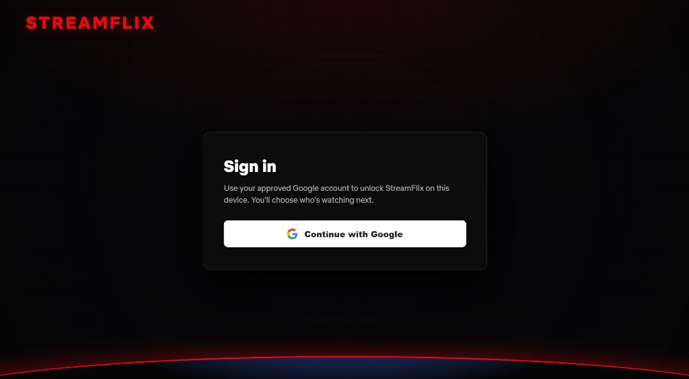
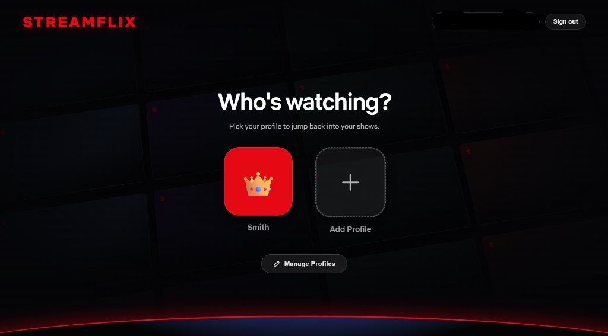
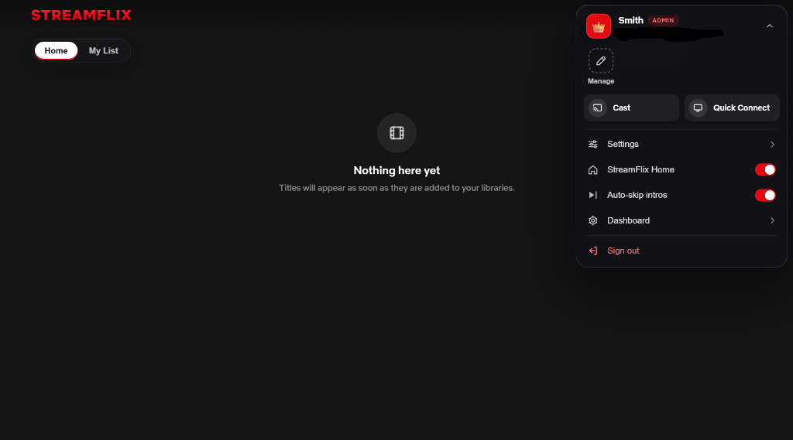

<div align="center">

# StreamFlix for Jellyfin

**A Netflix-style web UI, server-verified Google Sign-In gate, and household profiles backed by real Jellyfin users.**

[](manifest.json)
[](manifest.json)
[](Jellyfin.Plugin.StreamFlix/Jellyfin.Plugin.StreamFlix.csproj)
[](LICENSE)

Runs entirely inside your existing Jellyfin server — no reverse-proxy sidecar, external database, or manual HTML edits required.

</div>

---

## Preview

<table>
  <tr>
    <td width="50%" align="center">
      
      <br />
      <sub><b>1. Household Google Sign-In</b> — Clean pre-login gate with zero library exposure</sub>
    </td>
    <td width="50%" align="center">
      
      <br />
      <sub><b>2. Who's Watching?</b> — Per-member profiles with avatars, PINs &amp; Google locks</sub>
    </td>
  </tr>
  <tr>
    <td colspan="2" align="center">
      
      <br />
      <sub><b>3. StreamFlix Home &amp; Account Menu</b> — Segmented navigation, Cast, Quick Connect, StreamFlix Home &amp; Auto-skip Intros</sub>
    </td>
  </tr>
</table>

---

## Highlights

### Household Google Sign-In & Security
- **Sign in once per device.** Google ID tokens are verified on the Jellyfin server, which issues an HMAC-signed, revocable household session (30 days by default).
- **Strict allowlist.** Only Google accounts on your **Approved Google Accounts** list (or accounts locked to a profile) can unlock StreamFlix. No library artwork or metadata is exposed before signing in.
- **Profile-level locks.** Protect any profile with a **4–8 digit PIN** (server-checked with brute-force lockout) and/or lock it to a **specific Google email**.
- **Admin-only user linking.** Only Jellyfin administrators can view server accounts, edit admin-linked profiles, or change which Jellyfin user backs a profile.

### Real Multi-User Profiles
- **Separate history for everyone.** Every *"Who's watching?"* tile maps to its own Jellyfin Server User, keeping **Continue Watching, Next Up, My List, played state, and parental controls** completely independent.
- **Customizable avatars & accents.** Choose from 64 categorized icons and 14 accent colors (with one-click Shuffle); the active profile's color themes the interface.
- **Quick Connect & Cast built in.** Pair Smart TVs and other Jellyfin apps straight from the profile menu via **Quick Connect** — signing that device in as the active profile's Jellyfin user — or launch **Cast** in one click.

### Cinematic Home & Smart Collections
- **Living billboard & frosted navigation.** Edge-to-edge hero with title logos, ratings, ambient artwork color, and a header that transitions to frosted glass on scroll (`Home`, `Shows`, `Movies`, `Top 10`, `My List`, and `/` to search).
- **Rich hover previews.** Hover over any title for quick Play/Resume, My List, Watched, runtime/progress, and one-click **Remove from Continue Watching (`×`)** with a 5-second Undo toast.
- **Personalized & automatic rows.** Builds *Top Picks for You*, *Because You Watched…*, and *Watch It Again* per profile alongside curated rows like *Critically Acclaimed*, *Hidden Gems*, *Under 90 Minutes*, *Family Night*, *Binge-Worthy Series*, and decade picks.

### Netflix-Style Video Player
- **Streamlined controls.** Slim red scrubber, centered title, 10s/30s skip buttons, play/pause pulse feedback, and a *"You're watching"* pause screen.
- **In-player drawers & popovers.** Switch episodes instantly from the slide-in **Episodes & Seasons** drawer and change tracks live in the unified two-column **Audio & Subtitles** popover.
- **Seamless binge watching.** End-of-episode **Next Episode** countdown card (*Play Next* / *Watch Credits*) plus a per-profile **Auto-skip intros** toggle in the account menu.

### Desktop, Phone & Smart TV Ready
- **Mobile-tuned.** Single-row category bar with tap-to-expand search, touch-swipe hero billboard, 3-up snap-scrolling poster rows, bottom-sheet modals, and a collision-free landscape player.
- **10-foot Smart TV mode.** Automatically activates on `.layout-tv`, TV browsers, or `?tv=1` with overscan-safe margins, oversized poster/profile tiles, crisp focus halos, and full 2D spatial D-pad / remote navigation.

---

## Compatibility

The plugin repository manifest includes builds for all supported Jellyfin releases — Jellyfin automatically selects the package matching your server:

| Jellyfin Server | Target ABI | Runtime | Package |
| :--- | :--- | :--- | :--- |
| **12.x** (e.g. 12.4) | `12.0.0.0` | .NET 10.0 | `Jellyfin.Plugin.StreamFlix_12.0.0.zip` |
| **10.11.x** | `10.11.0.0` | .NET 9.0 | `Jellyfin.Plugin.StreamFlix_10.11.0.zip` |
| **10.9.x – 10.10.x** | `10.9.0.0` / `10.10.0.0` | .NET 8.0 | `Jellyfin.Plugin.StreamFlix_10.9.0.zip` |

---

## Installation

1. In Jellyfin, open **Dashboard → Plugins → Repositories** and add:
   ```text
   https://raw.githubusercontent.com/streamflix-dev/jellyfin-streamflix/main/manifest.json
   ```
2. Go to **Catalog**, locate **StreamFlix** (under *General*), and click **Install**.
3. **Restart Jellyfin** to load the plugin.

---

## Setup

1. Sign in to Jellyfin as an administrator and open **Dashboard → Plugins → StreamFlix**.
2. In [Google Cloud Console → Credentials](https://console.cloud.google.com/apis/credentials), create an **OAuth 2.0 Client ID** (*Web application*) and add the **Authorized JavaScript origins** and **Authorized redirect URIs** shown on the StreamFlix configuration page.
3. Paste your **Google Client ID**, enter your **Approved Google accounts** (one email per line), and click **Save**.
   *(On a fresh install with an empty allowlist, the first Google account to sign in is approved automatically.)*
4. Open **Manage Profiles** from the profile picker (or plugin settings) to create household profiles, link them to Jellyfin users, and configure PINs or Google account locks.

> [!TIP]
> If you link a profile to your Jellyfin administrator account, protect it with a **PIN** or **Google account lock** so other household members cannot switch into it.

> [!NOTE]
> Once a Google Client ID is saved, the login screen exclusively uses Google Sign-In (standard password login is only shown during initial setup). If you ever lock yourself out, stop Jellyfin, remove the StreamFlix plugin folder from your server's `plugins` directory, and restart.

---

## Building from Source

```bash
cd Jellyfin.Plugin.StreamFlix

dotnet build -c Release -p:JellyfinTarget=jf12     # Jellyfin 12.x        (.NET 10.0)
dotnet build -c Release -p:JellyfinTarget=jf1011   # Jellyfin 10.11       (.NET 9.0)
dotnet build -c Release -p:JellyfinTarget=jf109    # Jellyfin 10.9/10.10  (.NET 8.0)
```

Pushing code changes to `main` triggers [`.github/workflows/build-plugin.yml`](.github/workflows/build-plugin.yml), which compiles all three targets, packages `dist/*.zip`, and updates [`manifest.json`](manifest.json).

## Project Structure

```text
├── .github/workflows/build-plugin.yml   # Multi-target CI build & manifest generator
├── build.yaml                           # Jellyfin plugin build metadata
├── manifest.json                        # Jellyfin plugin repository manifest
├── docs/screenshots/                    # UI screenshots
└── Jellyfin.Plugin.StreamFlix/
    ├── Plugin.cs                        # Plugin entry point & throttled index.html injection
    ├── PluginServiceRegistrator.cs      # DI registration for services & startup filter
    ├── Configuration/
    │   ├── PluginConfiguration.cs       # Profiles, Google OAuth & session configuration
    │   └── configPage.html              # Admin UI (Dashboard → Plugins → StreamFlix)
    ├── Controllers/
    │   └── StreamFlixController.cs      # Auth, session, profile & asset endpoints
    ├── Services/
    │   ├── StreamFlixSessionService.cs  # HMAC household sessions & PIN lockout tracking
    │   ├── StreamFlixStartupFilter.cs   # Request-time index.html script/style injection
    │   └── StreamFlixStartupTask.cs     # Jellyfin user provisioning & profile linking
    └── Web/
        ├── streamflix.css               # Cinema theme, responsive/TV layouts & animations
        └── streamflix.js                # Sign-in gate, profile picker, home hub & player UI
```

## License

Licensed under the [GNU General Public License v3.0](LICENSE).

## Disclosure

AI tools assisted in the creation of this plugin, alongside a very long time spent designing, testing, and iterating to get everything working smoothly.
